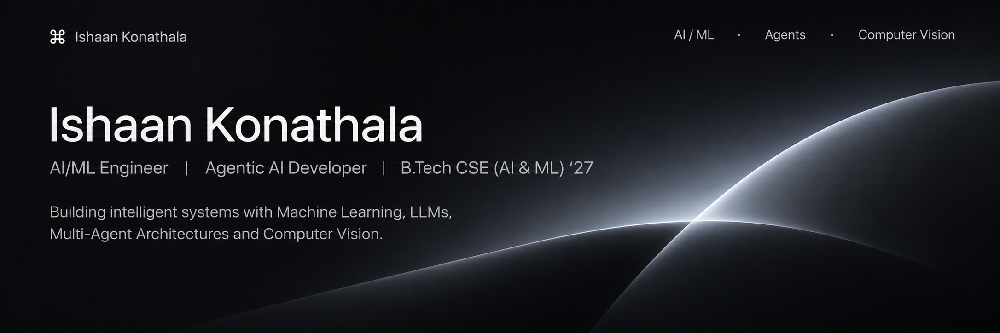

<!-- ═══════════════ HEADER BANNER ═══════════════ -->

  

<h1 align="center">Hey there, I'm Ishaan 👋</h1>

<h3 align="center">
  AI/ML Engineer | Agentic AI Developer | B.Tech CSE (AI & ML) '27
</h3>

  

  
  
  

---

## 👨‍💻 About Me

- 🎓 B.Tech Computer Science (AI & ML), graduating in 2027.
- 🤖 Interested in Agentic AI, LLMs and Generative AI.
- 🧠 Exploring Machine Learning, Deep Learning and Computer Vision.
- ⚙️ Building AI-powered applications and multi-agent systems.
- 🚀 Interested in developing practical solutions using intelligent technologies.
- 💡 Always learning, experimenting and building.

---

## 🛠️ Tech Stack

### Programming Languages

  
  

### AI / Machine Learning

  

### Agentic AI & Generative AI

  
  
  
  

### Backend & Tools

  

---

## 🚀 Featured Projects

### 01. SmartShopper V2
**Agentic AI Shopping Intelligence**

An intelligent shopping assistant built using LangGraph and multi-agent orchestration to understand user preferences and generate personalized product recommendations.

`LangGraph` `LLMs` `Multi-Agent AI` `FastAPI` `RAG`

### 02. TerraScope
**AI-Powered Satellite Land-Use Monitoring**

A satellite image analysis system for land-use monitoring and change detection using Siamese U-Net, Vision Transformers and Swin Transformers.

`Python` `PyTorch` `Computer Vision` `Swin Transformer`

[View Repository](https://github.com/ishaankonathala)

### 03. EquipSure
**AI-Powered Insurance Claims Automation**

An equipment insurance claims automation platform featuring backend services, intelligent workflows, authentication, messaging and notification systems.

`Python` `FastAPI` `PostgreSQL` `SQLAlchemy` `Gosu`

[View Repository](https://github.com/ishaankonathala/equipsure)

### 04. AI Emergency Traffic Management
**Computer Vision for Emergency Response**

An intelligent traffic management system designed to identify emergency vehicles using computer vision and support faster emergency response.

`Python` `OpenCV` `MobileNet` `Computer Vision`

[View Repository](https://github.com/ishaankonathala/ai-emergency-traffic-management)

### 05. Nestify
**Autonomous Multi-Agent DevSecOps System**

An AI-powered project planning and development system designed to support automated planning, code generation and deployment workflows.

`Python` `FastAPI` `Multi-Agent AI` `Docker`

[View Repository](https://github.com/ishaankonathala/nestify)

### 06. CertifyHub
**Bulk Certificate Generator API**

A backend API designed to automate bulk certificate generation and management.

`Python` `FastAPI` `API Development`

---

## 📊 GitHub Analytics

  
  

### 🔥 Contribution Streak

  

### 📈 Contribution Activity

  

---

## 🤝 Let's Connect

  
  

  <i>"Building intelligent systems, one project at a time."</i>

  ⭐ Thanks for visiting my profile!

